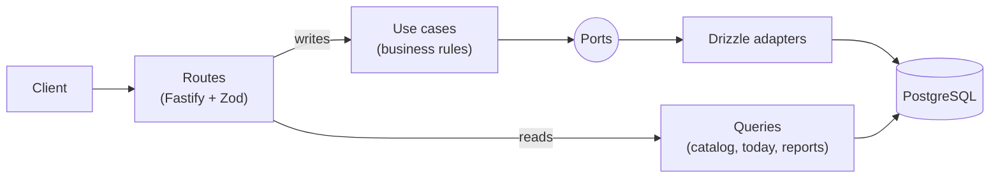

# Bambu Detailing

[](https://github.com/Kaleb-Nazar/bambu-detailing/actions/workflows/ci.yml)
[](LICENSE)

Management system for a real car wash in Mexico. Operators register each car from their phone,
see the queue of the day and change its status. The owner sees weekly income, the average ticket
and how much was spent on cleaning supplies.

> 🚧 Work in progress. The API is ready; the web app is next.

## Features

**Ready**

- Catalog of wash packages (Express, Basic, Plus) and extras, priced per vehicle type.
- Register a service: the plate is optional and normalized, prices always come from the catalog
  and are copied into the service, so a price change never alters past reports.
- Queue of the day with status changes (`waiting` → `washing` → `ready` → `delivered`).
- Supplies: log every purchase of materials (shampoo, microfiber cloths...) with free quantity,
  unit and price. A new supplier is created on the fly with just its name.
- Weekly report: income, services, average ticket, supplies spending and net, day by day,
  in Mexico City time.
- OpenAPI docs generated from the validation schemas.

**Next**

- Web app: landing page with prices, a mobile-first panel and the weekly report.
- Integration tests against a real PostgreSQL.
- Online booking, sign-in with roles, real-time updates and deployment.

## Tech stack

End-to-end TypeScript in a pnpm monorepo:

- **API:** Node.js 26, Fastify, Zod, PostgreSQL 18 and Drizzle ORM.
- **Web (next):** React, React Router and Tailwind CSS.
- **Tooling:** Turborepo, Biome, Vitest, Husky, commitlint, Docker Compose and GitHub Actions.

## Architecture

A modular monolith with a pragmatic hexagonal architecture: ports and adapters only where there
are business rules. See [ADR 0001](docs/adr/0001-modular-monolith-hexagonal.md).



- **Writes** (register a service or a purchase) go through a use case that knows nothing about
  Fastify or Drizzle, so it is tested in milliseconds with in-memory fakes.
- **Reads** (catalog, queue of the day, weekly report) are plain queries. The report is plain SQL.
- `src/container.ts` is the only place that connects each port with its adapter.

```
apps/api/src
├─ modules/
│  ├─ catalog/      # packages, extras and prices
│  ├─ services/     # domain (plate, total), use case, Drizzle adapters, routes
│  ├─ supplies/     # supplies, suppliers and purchases
│  └─ reports/      # weekly report (SQL)
├─ db/              # Drizzle schema, client and seed
├─ shared/          # domain error, time zone
├─ container.ts     # composition root
└─ app.ts           # Fastify app (no port, easy to test)
```

## Getting started

Requirements: Node.js 26 (see `.nvmrc`), pnpm through Corepack (`corepack enable`) and Docker.

```bash
cp .env.example .env
pnpm install
docker compose up -d                  # PostgreSQL on port 5432
pnpm --filter @bambu/api db:migrate   # create the tables
pnpm --filter @bambu/api db:seed      # fake data
pnpm --filter @bambu/api dev          # http://127.0.0.1:3000
```

Open **http://127.0.0.1:3000/docs** to try every endpoint.

`docker compose down` stops PostgreSQL; `docker compose down -v` also deletes its data.

## API

| Method  | Path                              | Description                                    |
| ------- | --------------------------------- | ---------------------------------------------- |
| `GET`   | `/health`                         | The API is alive                               |
| `GET`   | `/catalog`                        | Vehicle types, packages and extras with prices |
| `POST`  | `/services`                       | Register a service                             |
| `GET`   | `/services/today`                 | Services of today                              |
| `PATCH` | `/services/:id/status`            | Change the status of a service                 |
| `GET`   | `/supplies`                       | Supplies catalog                               |
| `GET`   | `/suppliers`                      | Suppliers                                      |
| `POST`  | `/purchases`                      | Register a supplies purchase                   |
| `GET`   | `/reports/weekly?date=YYYY-MM-DD` | Weekly report (Monday to Sunday)               |

Errors are JSON: `400` when the request has the wrong shape, `422` when a business rule fails
(for example an invalid plate) and `404` when something does not exist.

## Scripts

| Command                                | What it does                       |
| -------------------------------------- | ---------------------------------- |
| `pnpm lint`                            | Lint and format check with Biome   |
| `pnpm typecheck`                       | Type check every package           |
| `pnpm test`                            | Run the tests with Vitest          |
| `pnpm build`                           | Build every package                |
| `pnpm --filter @bambu/api db:generate` | Create a migration from the schema |
| `pnpm --filter @bambu/api db:studio`   | Browse the database                |

## Decisions

- [ADR 0001: Modular monolith with pragmatic hexagonal architecture](docs/adr/0001-modular-monolith-hexagonal.md)
- [ADR 0002: Monorepo with pnpm workspaces and Turborepo](docs/adr/0002-monorepo.md)
- [Glossary](docs/glossary.md): the UI is in Spanish and the code is in English.

Other choices worth knowing:

- Money is stored as integer cents (`$150.00` = `15000`) to avoid rounding errors.
- Services keep a copy of each name and price (`service_items`), so history never changes.
- "Today" and "this week" are computed in `America/Mexico_City`; the database stores UTC.

## Contributing

Branch per change, [Conventional Commits](https://www.conventionalcommits.org) and a green CI
before merging. Husky runs Biome on staged files and commitlint on every commit.

## License

[MIT](LICENSE)
